# Doctor Tracker


A secure admin dashboard for managing doctors, their patients, and the numbers behind them.

## Elevator Pitch

Doctor Tracker is an internal admin tool for clinics and hospital groups that need one place to keep their doctor directory and patient assignments in order. An authenticated admin can add, edit, search, and filter doctors and patients, open any doctor to see everyone assigned to them, and follow activity on a dashboard with headline stats and charts. It is built as a Next.js + TypeScript client talking to a standalone Express + MongoDB REST API, with the session held in an httpOnly cookie.

## Live Demo & Credentials

- **Live URL:** https://doctor-tracker-zeta.vercel.app/
- **Repository:** [ADD LINK]

| Email               | Password |
| ------------------- | -------- |
| `admin@example.com` | `123456` |

## Features

### Authentication

- Email + password login against the API; passwords are hashed with bcrypt (12 rounds).
- Session is a signed JWT stored in an **httpOnly, SameSite=Lax** cookie (`Secure` in production).
- Every doctor, patient, and dashboard endpoint is protected by an Express auth middleware.
- Client-side route guard: protected pages call `GET /api/auth/me` and redirect to `/login` when there is no valid session.
- Logout clears the cookie; `/` redirects to `/login`.
- One-off CLI script to create the first admin (`npm run seed:admin`).

### Doctor Management

- Paginated doctor list (10 per page) with a table on desktop and cards on mobile.
- Search across name, specialization, hospital, and email; filter by specialization, hospital, and date added.
- Text filters are debounced (400 ms) before hitting the API.
- Create and edit in a modal with client-side validation; server-side validation in the API.
- Delete with a confirmation modal.
- Doctor detail page with profile info and a paginated list of that doctor's patients.

### Patient Management

- Paginated patient list with search across name, phone, and condition.
- Filters for condition, gender, assigned doctor (dropdown loaded from the API), and date added.
- Create, edit, and delete via modals; each patient is assigned to one doctor.
- Patient rows link to their doctor's detail page.

### Dashboard & Analytics

- Stat cards: total doctors, total patients, new patients this month (with % change vs. last month), and patients added in the last 30 days.
- "Patients added over time" area chart with **7D / 30D / 12M** range tabs; empty days/months are filled with zero.
- "Patients per doctor" bar chart (top 10); clicking a bar opens that doctor.
- "Doctors by specialization" bar chart.
- All figures come from MongoDB `countDocuments` and aggregation pipelines on the server.

> The date-range picker in the dashboard header is UI only for now: it updates the page subtitle but is not yet wired to the stats or charts.

### UI/UX

- Responsive layout: collapsible sidebar on desktop, slide-out menu on mobile.
- Loading skeletons, empty states, and inline error messages with a "Try again" action.
- Previous results stay on screen while the next page or filter loads, so tables don't jump.
- Accessible modals and menus (Escape to close, `aria-modal`, labelled controls).
- Custom date-range picker built on `date-fns`; icons from `lucide-react`.

> The header search box and notification bell are visual placeholders and have no behavior yet.

## Tech Stack

| Layer         | Technology                            | Why                                                                   |
| ------------- | ------------------------------------- | --------------------------------------------------------------------- |
| Framework     | Next.js 16 (App Router)               | File-based routing, route groups for auth vs. protected layouts.      |
| Language      | TypeScript (frontend and backend)     | Shared, checked types for API payloads and models.                    |
| Styling       | Tailwind CSS 4                        | Fast, consistent responsive styling without a component library.      |
| Server state  | TanStack Query 5 (dashboard)          | Caching, deduped requests, and smooth range switching for charts.     |
| Charts        | Recharts 3                            | Composable React charts with responsive containers.                   |
| Dates / icons | date-fns, lucide-react                | Small, tree-shakeable utilities.                                      |
| API           | Node.js + Express 5                   | Minimal, well-known REST framework with simple middleware.            |
| Database      | MongoDB + Mongoose 9                  | Flexible documents, schema validation, and aggregation for analytics. |
| Auth          | jsonwebtoken, bcryptjs, cookie-parser | Stateless JWT sessions in an httpOnly cookie; hashed passwords.       |
| API hardening | helmet, cors (credentials), morgan    | Security headers, a single allowed origin, request logging.           |
| Tooling       | ESLint, tsx, Playwright               | Linting, TS dev server with watch mode, automated README screenshots. |

## Setup Guide

### Prerequisites

- **Node.js 20.9 or newer** (required by Next.js 16; developed on Node 24). No `engines` field is set in `package.json`.
- **npm** 10+
- **MongoDB** 6+ running locally, or a MongoDB Atlas connection string

### 1. Clone and install

```bash
git clone [ADD LINK] doctor-tracker
cd doctor-tracker

cd backend && npm install
cd ../frontend && npm install
```

### 2. Configure and start the backend

```bash
cd backend
cp .env.example .env
```

Edit `backend/.env` and set at least `MONGODB_URI` and `JWT_SECRET` (32+ characters). See [`backend/.env.example`](backend/.env.example) for every variable.

Create the demo admin account (uses `ADMIN_NAME`, `ADMIN_EMAIL`, `ADMIN_PASSWORD` from `.env`, or pass them inline):

```bash
ADMIN_NAME="Demo Admin" ADMIN_EMAIL=admin@doctortracker.com ADMIN_PASSWORD='Admin@123' npm run seed:admin
```

Start the API:

```bash
npm run dev
# Doctor Tracker API running on http://localhost:5000
```

Check it with:

```bash
curl http://localhost:5000/api/health
```

### 3. Configure and start the frontend

In a second terminal:

```bash
cd frontend
cp .env.example .env.local
npm run dev
```

[`frontend/.env.example`](frontend/.env.example) contains a single variable, `NEXT_PUBLIC_API_URL` (default `http://localhost:5000/api`).

### 4. Log in

Open [http://localhost:3000](http://localhost:3000) and sign in with `admin@doctortracker.com` / `Admin@123`.

There is no data seeder for doctors and patients yet, so add a few through the UI to populate the dashboard.

### Available npm scripts

**Backend** (`backend/`)

| Script               | Description                                           |
| -------------------- | ----------------------------------------------------- |
| `npm run dev`        | Start the API with `tsx watch` (reloads on change).   |
| `npm run build`      | Compile TypeScript to `dist/`.                        |
| `npm start`          | Run the compiled API from `dist/server.js`.           |
| `npm run seed:admin` | Create an admin account from the `ADMIN_*` variables. |

**Frontend** (`frontend/`)

| Script                | Description                                                                    |
| --------------------- | ------------------------------------------------------------------------------ |
| `npm run dev`         | Start the Next.js dev server on port 3000.                                     |
| `npm run build`       | Production build.                                                              |
| `npm start`           | Serve the production build.                                                    |
| `npm run lint`        | Run ESLint.                                                                    |
| `npm run screenshots` | Capture README screenshots with Playwright (frontend and API must be running). |

To regenerate screenshots the first time, install the browser once:

```bash
cd frontend
npx playwright install chromium
npm run screenshots
```

## System Architecture

```mermaid
flowchart LR
    B[Browser] --> N

    subgraph N[Next.js frontend :3000]
        direction TB
        G["ProtectedRoute guard<br/>(app/(protected)/layout.tsx)"] --> P[Pages<br/>dashboard, doctors, patients]
        P --> H["Data hooks<br/>TanStack Query (dashboard)<br/>useDoctors / usePatients"]
        H --> S["Service layer<br/>lib/doctors.ts, lib/patients.ts,<br/>features/dashboard/api.ts"]
        S --> C["apiRequest()<br/>fetch + credentials: include"]
    end

    C -- "HTTP + httpOnly cookie<br/>NEXT_PUBLIC_API_URL" --> E

    subgraph E[Express REST API :5000]
        direction TB
        M[helmet, cors, cookie-parser] --> A[authenticateAdmin<br/>JWT check]
        A --> R[Routes → Controllers<br/>validators]
    end

    R -- "Mongoose queries<br/>and aggregations" --> D[(MongoDB)]
```

The frontend calls the Express API directly at `NEXT_PUBLIC_API_URL`. There are no mock routes under `src/app/api` and no Next.js `/api` rewrite; the browser sends the auth cookie because requests use `credentials: "include"` and the API allows the frontend origin with `credentials: true`.

### Data flow example: changing the dashboard range

1. The admin clicks **12M** on the "Patients added over time" card. `RangeTabs` updates local state in `PatientsOverTimeCard`.
2. `usePatientsOverTime(range)` runs with the query key `["dashboard", "patients-over-time", "12m"]`. A new key means a new cache entry.
3. If that key is cached and fresh (`staleTime` 60 s), TanStack Query returns it immediately. Otherwise it calls `getPatientsOverTime("12m")`, while `placeholderData: keepPreviousData` keeps the previous chart on screen.
4. `apiRequest` sends `GET /api/dashboard/patients-over-time?range=12m` with the session cookie.
5. `authenticateAdmin` verifies the JWT, then the controller runs a MongoDB aggregation: `$match` on `createdAt`, `$group` by `$dateToString` (month buckets, `Asia/Dhaka` timezone), `$sort`. Missing months are filled with `0` in the controller.
6. The response is cached under that key. Switching back to **30D** within 60 seconds is served from cache with no request.
7. The lazily loaded Recharts `AreaChart` re-renders with the new series.

### Authentication flow

1. **Login.** `LoginForm` posts `{ email, password }` to `POST /api/auth/login`. The API looks up the admin, compares the bcrypt hash, signs a JWT (`sub` = admin id, `JWT_EXPIRES_IN`, default 1 day), and sets it as the `doctor_tracker_token` cookie (`httpOnly`, `SameSite=Lax`, `Secure` in production).
2. **Session check.** On app load, `AuthProvider` calls `GET /api/auth/me`. The cookie is sent automatically; the API returns the admin or `401`.
3. **Route protection.** `app/(protected)/layout.tsx` wraps every admin page in `ProtectedRoute`, which shows a loader while the session check runs and redirects to `/login` if there is no admin.
4. **API enforcement.** The client guard is for UX only. The real enforcement is `authenticateAdmin` on every `/api/doctors`, `/api/patients`, and `/api/dashboard` route, which rejects requests without a valid token.
5. **Logout.** `POST /api/auth/logout` clears the cookie and the client redirects to `/login`.

There is no Next.js `middleware.ts`, so protected pages are guarded on the client rather than at the edge. See [Future Improvements](#future-improvements).

### Folder structure

```text
doctor-tracker/
├── backend/
│   ├── scripts/              # seed-admin.ts: create the first admin account
│   └── src/
│       ├── config/           # MongoDB connection
│       ├── controllers/      # Request handlers (auth, doctors, patients, dashboard)
│       ├── middleware/       # authenticateAdmin JWT cookie check
│       ├── models/           # Mongoose schemas and indexes (Admin, Doctor, Patient)
│       ├── routes/           # Express routers mounted under /api
│       ├── services/         # Dashboard aggregation service
│       ├── types/            # Express Request augmentation (req.admin)
│       ├── utils/            # JWT signing and bcrypt helpers
│       ├── validators/       # Input validation for doctors and patients
│       └── server.ts         # App setup and startup
├── frontend/
│   ├── scripts/              # screenshots.ts: Playwright README captures
│   └── src/
│       ├── app/
│       │   ├── (auth)/       # Public routes: /login
│       │   └── (protected)/  # Guarded routes: /dashboard, /doctors, /doctors/[id], /patients
│       ├── components/       # Shared UI: auth guard, layout, modal, pagination, date picker
│       ├── context/          # AuthProvider and useAuth
│       ├── features/         # Feature modules (dashboard, doctors, patients): components + hooks
│       ├── lib/              # apiRequest and REST service functions
│       ├── providers/        # TanStack QueryClient provider
│       └── types/            # Shared TypeScript types for API payloads
└── docs/
    └── screenshots/          # README screenshots (generated)
```

## Technical Decisions

### a) TanStack Query for server state instead of Redux or Context

**Context.** Almost all state in this app is server state: lists, details, and aggregated stats that live in MongoDB. It needs caching, loading and error states, and refetching, not complex client-side transitions.

**Options considered.**

- **Redux Toolkit (or RTK Query):** powerful, but adds a store, slices, and conventions that a small admin tool doesn't need.
- **React Context + `useEffect`:** no dependency, but every caching, deduping, and stale-data rule has to be written by hand.
- **TanStack Query:** purpose-built for server state with caching, deduping, and background refetching.

**Decision.** Use TanStack Query for server data, and keep React Context only for the one piece of global client state: the logged-in admin (`AuthProvider`).

**Why.**

- **Caching by key.** Each dashboard query has a key like `["dashboard", "patients-over-time", range]`, so switching between 7D, 30D, and 12M reuses cached results.
- **Request dedupe.** Components that ask for the same key share one request.
- **`keepPreviousData`.** The chart keeps the old series while the new range loads instead of flashing a skeleton.
- **Sane defaults in one place.** `providers.tsx` sets `staleTime: 30s`, `retry: 1`, and no refetch on window focus for the whole app.
- **Less boilerplate** than reducers and actions for what is essentially "fetch and cache."

**Trade-offs and current status.**

- Adds a dependency and a mental model (query keys, stale vs. cached).
- **Adoption is partial.** Only the dashboard uses TanStack Query today. The doctors, patients, and doctor-detail pages use small hand-written hooks (`useDoctors`, `usePatients`, `useDoctor`) built on `useEffect`. They mimic `keepPreviousData` (old rows stay visible during loads) and ignore stale responses, but have no shared cache. After create, update, or delete they call a local `refetch()` instead of `invalidateQueries`. Moving these to `useQuery` + `useMutation` with targeted invalidation is the next step (see [Future Improvements](#future-improvements)).

### b) Separate Next.js client and standalone Express REST API

**Context.** The app needs a UI, authentication, CRUD, and analytics aggregations. These could live in one Next.js app (Route Handlers / Server Actions) or be split.

**Options considered.**

- **Next.js only:** one deploy, but database access, auth, and aggregations become coupled to the frontend framework and its release cycle.
- **Separate Express API + Next.js client:** two deploys, but a clean, framework-agnostic REST contract.

**Decision.** Build a standalone Express 5 + Mongoose API (`backend/`) and a Next.js client (`frontend/`) that talks to it only through REST.

**Why.**

- **Separation of concerns.** The backend owns validation, auth, and data access; the frontend owns UI and caching.
- **Independent scaling and deployment.** The API is stateless (JWT in a cookie), so it can scale horizontally separately from the frontend.
- **A clear contract.** All calls go through one `apiRequest()` helper and typed service functions in `lib/` and `features/dashboard/api.ts`. Response shapes are mirrored in `src/types`, so swapping the API URL (`NEXT_PUBLIC_API_URL`) needs no component changes.
- **Reusable.** The same API could serve a mobile app or another client.

**Trade-offs.**

- Two services to run, configure, and deploy, and CORS to manage (`FRONTEND_URL` + `credentials: true`).
- **Cookie scope.** The frontend currently calls the API cross-origin. This works locally because `localhost:3000` and `localhost:5000` are the same site. If the two are deployed on unrelated domains, a `SameSite=Lax` cookie will not be sent. The intended fix is a Next.js `/api` rewrite (or a shared parent domain) so the cookie stays first-party. That rewrite is **not implemented yet**.
- The request/response types are duplicated between `backend/` and `frontend/` rather than shared in a package.

## Performance & Optimization

### Implemented

- **MongoDB indexes** (defined in the Mongoose models):
  - Doctors: `{ createdAt: -1 }`, `{ name: 1 }`, `{ specialization: 1 }`, `{ hospital: 1 }`, `{ email: 1 }`
  - Patients: `{ createdAt: -1 }`, `{ name: 1 }`, `{ condition: 1 }`, `{ doctor: 1 }`, `{ doctor: 1, createdAt: -1 }`
  - Admins: unique `{ email: 1 }`
- **Aggregation pipelines** for analytics: patients over time (`$match` → `$group` by `$dateToString` → `$sort`), patients per doctor (`$group` → `$lookup` → `$sort` → `$limit`), and doctors by specialization (`$group` → `$sort`).
- **Parallel queries.** List endpoints run `find` and `countDocuments` with `Promise.all`; dashboard stats run five counts in parallel.
- **Server-side pagination everywhere.** `page` and `limit` (max 100) on every list endpoint; list queries use `.lean()`.
- **Safe search.** User input is regex-escaped before case-insensitive matching.
- **Debounced search** (400 ms) on the doctors and patients filter inputs.
- **Query caching** on the dashboard: `staleTime` of 30–60 s, `keepPreviousData` on range changes, no refetch on window focus.
- **Lazy-loaded chart.** The patients-over-time chart is loaded with `next/dynamic` (`ssr: false`), keeping Recharts out of the initial bundle for that card.
- **No layout jumps.** List hooks keep previous rows visible while the next page loads.

### Planned / not yet done

- **Text indexes.** Search currently uses case-insensitive regex, which cannot use a B-tree index efficiently on large collections. Planned: a text index on doctors `name`/`email`/`hospital` and patients `name`/`phone` (patients have no `email` field today).
- Indexes such as `{ condition: 1, admissionDate: -1 }` and `{ status: 1 }` are not applicable yet because the patient model has no `admissionDate` or `status` field.
- **URL-based filters.** Filters and page number live in component state, so they are lost on refresh and can't be shared as links.
- **Memoization.** No `useMemo` / `React.memo` is used; at the current data sizes it hasn't been needed.
- The two horizontal bar charts are not lazy-loaded yet.

## API Overview

All endpoints are prefixed with `/api`. Everything except login, logout, and health requires the auth cookie.

### Called by the frontend

| Method   | Path                                      | Description                                                                                                        |
| -------- | ----------------------------------------- | ------------------------------------------------------------------------------------------------------------------ |
| `POST`   | `/auth/login`                             | Log in; sets the `doctor_tracker_token` cookie.                                                                    |
| `GET`    | `/auth/me`                                | Current admin from the cookie.                                                                                     |
| `POST`   | `/auth/logout`                            | Clear the auth cookie.                                                                                             |
| `GET`    | `/doctors`                                | List doctors. Query: `page`, `limit`, `search`, `specialization`, `hospital`, `from`, `to`.                        |
| `POST`   | `/doctors`                                | Create a doctor.                                                                                                   |
| `GET`    | `/doctors/:id`                            | Get one doctor.                                                                                                    |
| `PATCH`  | `/doctors/:id`                            | Update a doctor.                                                                                                   |
| `DELETE` | `/doctors/:id`                            | Delete a doctor.                                                                                                   |
| `GET`    | `/patients`                               | List patients (doctor populated). Query: `page`, `limit`, `search`, `condition`, `gender`, `doctor`, `from`, `to`. |
| `POST`   | `/patients`                               | Create a patient.                                                                                                  |
| `PATCH`  | `/patients/:id`                           | Update a patient.                                                                                                  |
| `DELETE` | `/patients/:id`                           | Delete a patient.                                                                                                  |
| `GET`    | `/dashboard/stats`                        | Totals, new this month, monthly % change, last-30-day count.                                                       |
| `GET`    | `/dashboard/patients-over-time?range=`    | Time series; `range` is `7d`, `30d`, or `12m`.                                                                     |
| `GET`    | `/dashboard/patients-per-doctor?limit=10` | Top doctors by patient count.                                                                                      |
| `GET`    | `/dashboard/by-specialization`            | Doctor count per specialization.                                                                                   |

### Available but not used by the frontend yet

| Method | Path                   | Description                                                                  |
| ------ | ---------------------- | ---------------------------------------------------------------------------- |
| `GET`  | `/health`              | Health check.                                                                |
| `GET`  | `/patients/:id`        | Get one patient.                                                             |
| `GET`  | `/dashboard?from=&to=` | Combined summary, patients by doctor, and patients by date for a date range. |

## Visual Evidence

Generated with `npm run screenshots` (Playwright, 1440×900 desktop and 390×844 mobile).

| Page          | Desktop                                                               | Mobile                                                                                        |
| ------------- | --------------------------------------------------------------------- | --------------------------------------------------------------------------------------------- |
| Login         | 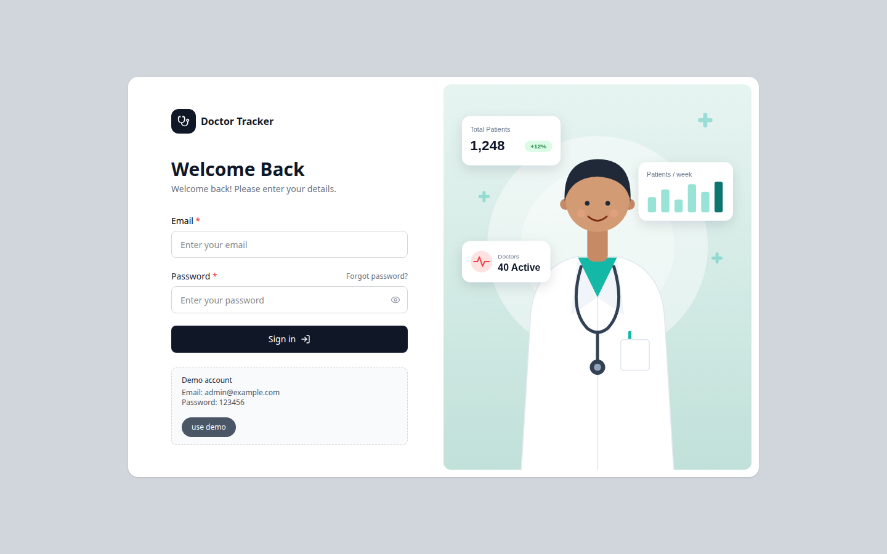                 | 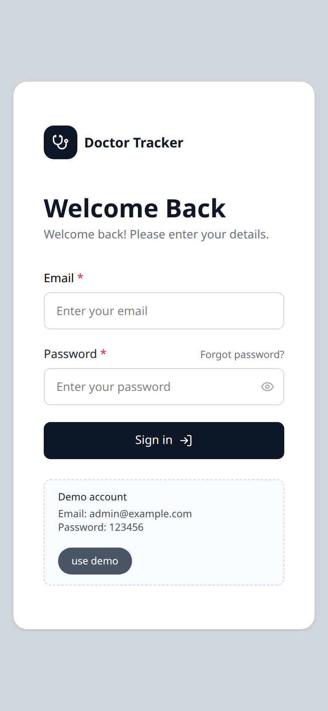                 |
| Dashboard     | 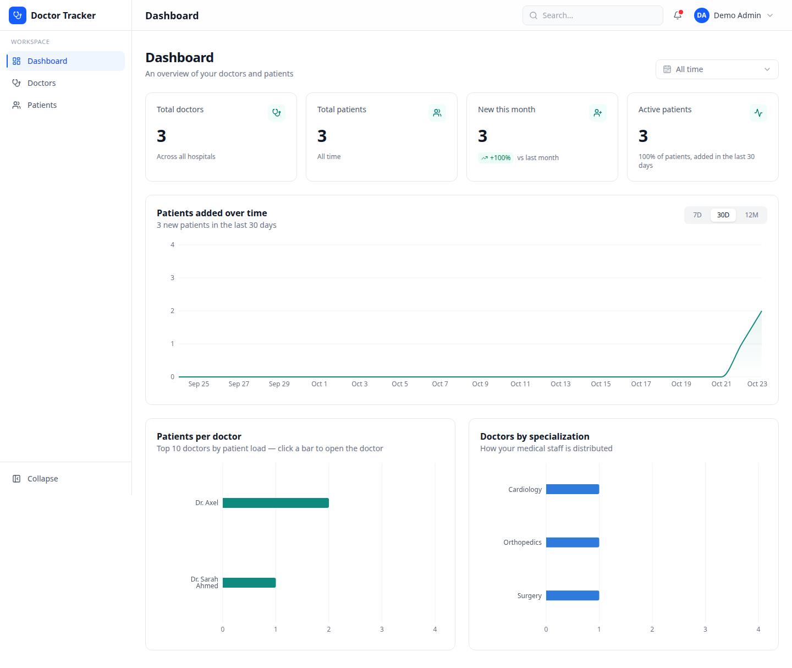         | 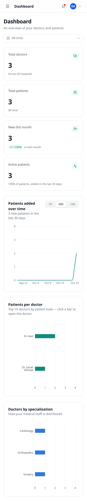         |
| Doctors       | 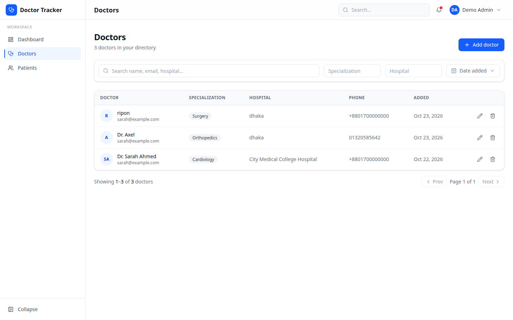             | 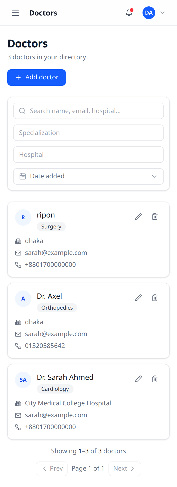             |
| Doctor Detail | 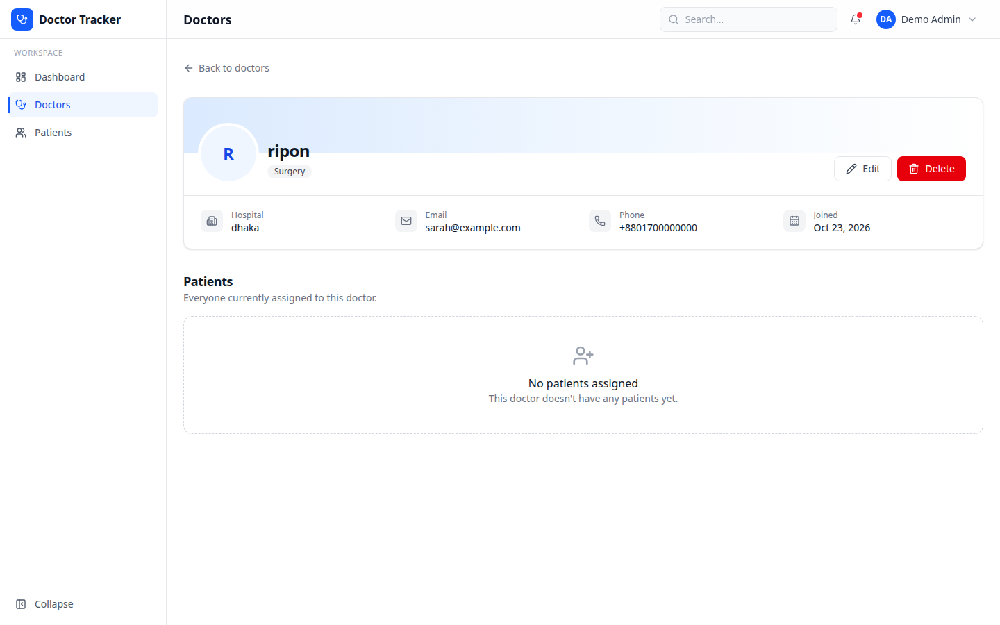 | 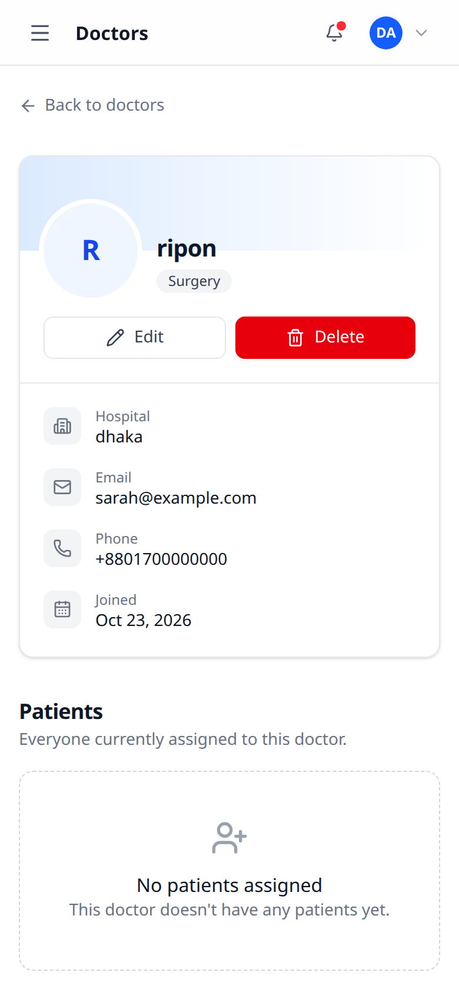 |
| Patients      | 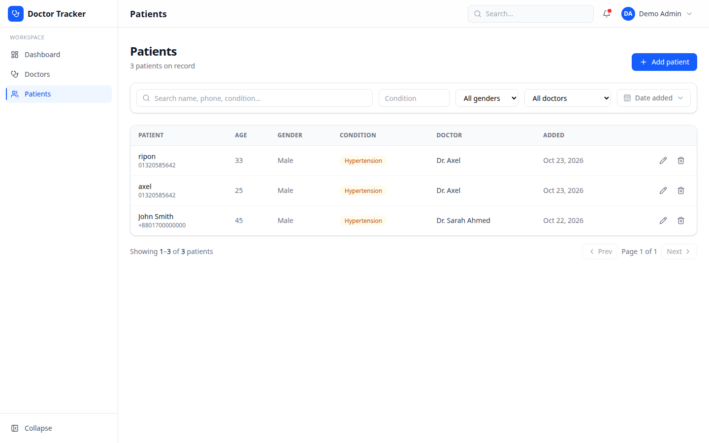           | 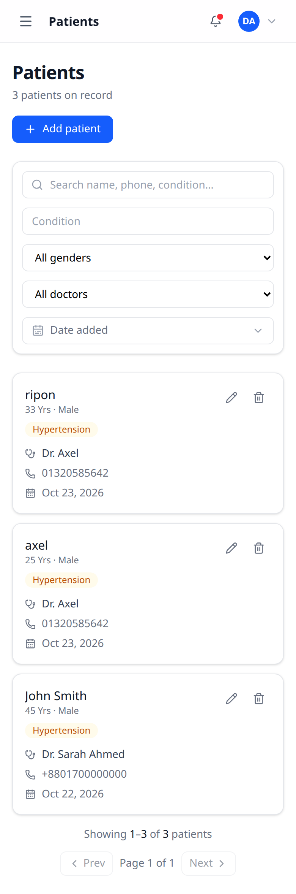           |

## Scalability Considerations

- **Stateless API.** Sessions are JWTs in a cookie, so any API instance can serve any request and instances can be added behind a load balancer.
- **Independent scaling.** Frontend and API are separate deployables and can scale on their own.
- **Indexed queries.** Common sort and filter fields, plus the `{ doctor, createdAt }` compound used by "patients of a doctor", are indexed.
- **Pagination everywhere.** Every list endpoint is paginated with a hard cap of 100 per page.
- **Aggregation in the database.** Dashboard numbers are computed in MongoDB rather than by loading documents into Node.
- **Client caching.** TanStack Query caches dashboard data and avoids duplicate requests.
- **Feature-based structure.** `features/dashboard`, `features/doctors`, and `features/patients` each own their components and hooks, so new features can be added without touching unrelated code.

## Future Improvements

- **Server-side route protection.** Add a Next.js `middleware.ts` cookie check and an `/api` rewrite to the Express API so the auth cookie is first-party in production and unauthenticated users are redirected before any page renders.
- **TanStack Query everywhere.** Move doctors and patients to `useQuery` / `useMutation` with targeted `invalidateQueries`, and keep filters and page in the URL.
- **Data integrity.** Deleting a doctor currently leaves their patients pointing to a missing doctor. Block the delete, reassign, or cascade in a transaction.
- **Wire up the dashboard date picker** to the existing `GET /api/dashboard?from=&to=` endpoint, and implement or remove the header search and notifications.
- **Search at scale.** Replace regex search with text or Atlas Search indexes, and add a seed script for realistic demo data.
- **Testing and hardening.** There are no automated tests yet. Add API integration tests and Playwright E2E tests, login rate limiting, and a shared types package for the API contract.

## Author

**Ripon Mardy**

- GitHub: [github.com/Ripon-Mardy](https://github.com/Ripon-Mardy)
- LinkedIn: [linkedin.com/in/riponmardy](https://www.linkedin.com/in/riponmardy)
- Portfolio: [riponmardy.vercel.app](https://riponmardy.vercel.app)
